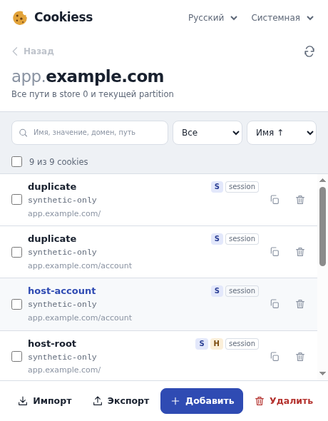
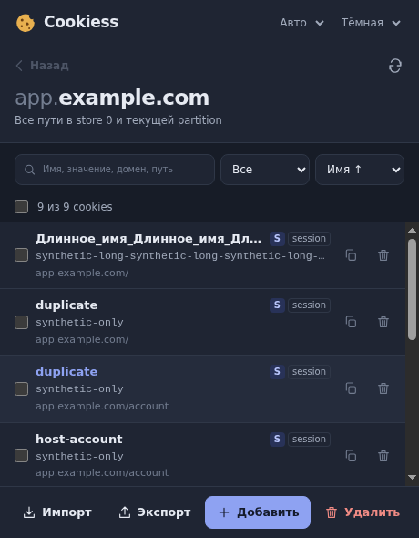
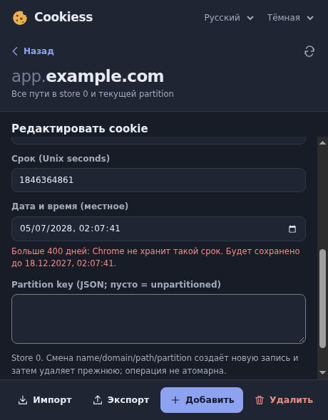
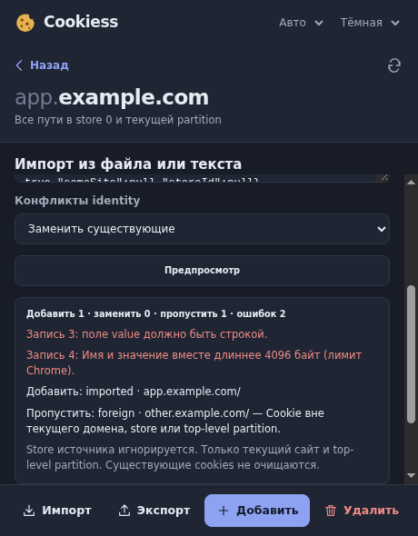
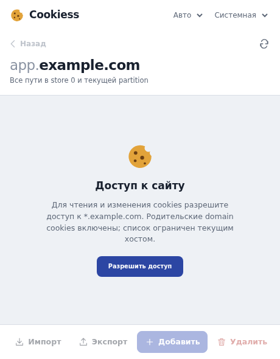

<div align="center">

**English** · [Русский](README_RU.md)


# Cookiess

**A local cookie manager for the current site in Chrome**

View, edit, import and export cookies — no server, no analytics, no network requests.

[](https://github.com/smallp80380/cookiess/actions/workflows/ci.yml)
[](https://github.com/smallp80380/cookiess/releases/latest)
[](LICENSE)


[**Download**](https://github.com/smallp80380/cookiess/releases/latest/download/cookiess-latest.zip) · [Install](#install) · [Features](#features) · [Privacy](#privacy) · [Development](#development)

<br>

&nbsp;&nbsp;

</div>

## Features

- **Every cookie of the site in one list** — on every path, including parent-domain and partitioned cookies of the current site. Other domains, other tabs and third-party iframes stay out.
- **Fast search** by name, value, domain and path; filter by Secure, HttpOnly, session and partitioned; sort by name, domain, path or expiry.
- **Readable expiry** — “in 3 d” right in the list, the exact date on hover, and a local date-and-time field in the editor.
- **A full attribute editor** with validation: domain, path, Secure, HttpOnly, SameSite, expiry and partition key. `__Host-` and `__Secure-` prefixes are checked against the browser’s rules.
- **Decoded values** — URL-encoded, Base64 and JWT values are shown in readable form.
- **Safe removal** — confirmation, an optional backup file, and Undo while the popup stays open.
- **Import and export** in Cookiess JSON, Cookie-Editor JSON and Netscape `cookies.txt`, with a preview, a conflict policy and progress.
- **English and Russian UI**, light, dark and system themes, and the <kbd>Alt</kbd>+<kbd>Shift</kbd>+<kbd>K</kbd> shortcut.

<table>
  <tr>
    <td width="33%"></td>
    <td width="33%"></td>
    <td width="33%"></td>
  </tr>
  <tr>
    <td align="center"><sub>Editor and expiry</sub></td>
    <td align="center"><sub>Import preview</sub></td>
    <td align="center"><sub>Site access request</sub></td>
  </tr>
</table>

<sub>All screenshots show the real extension popup with synthetic test data. The interface follows your browser language; these were taken in Russian.</sub>

## Install

1. Download [`cookiess-latest.zip`](https://github.com/smallp80380/cookiess/releases/latest/download/cookiess-latest.zip) and unzip it into a permanent folder.
2. Open `chrome://extensions` and turn on **Developer mode**.
3. Click **Load unpacked** and select the folder that contains `manifest.json`.
4. Pin Cookiess to the toolbar, open any HTTP/HTTPS site and click the icon.
5. The first time on a site, click **Allow access** and confirm Chrome’s prompt.

**Updating.** Unzip the new archive into the same folder and click Reload in `chrome://extensions`. Loading a new version from a different folder creates a second extension, and the old pinned icon may point to a deleted folder and show `ERR_FILE_NOT_FOUND` — remove the old installation.

Works in Chrome 132+ and other Chromium-based browsers. In incognito it works only if you allow it in the extension settings; normal and private cookies are never mixed.

## How it works

**Access.** Cookiess does not get access to every site at once. It asks for the registrable domain of the open site (for example `*.example.com`), which is needed to see parent-domain cookies. For `localhost` and IP addresses it asks for the host itself. You can revoke access in the extension settings.

**Changes.** Before every write Cookiess re-checks the tab and the permission, and after the write it re-reads the actual result from Chrome. If the tab has moved to another site, writes are blocked until you refresh.

**Renaming.** Changing a cookie’s name, domain, path or partition creates a new cookie and then removes the old one. The browser cannot do this atomically, so if the second step fails Cookiess tells you that both records are in the list.

**Ambiguous removal.** Chrome removes cookies by URL and name. When several same-name cookies match that URL, Cookiess refuses to remove one and tells you the order to use — the record with the shorter path first.

## File formats

| Format | Keeps | Limits |
| --- | --- | --- |
| **Cookiess JSON** | Every Chrome attribute and the full partition key | — |
| **Cookie-Editor JSON** | An array of objects compatible with Cookie-Editor | Drops the store; `sameSite: null` means Unspecified |
| **Netscape `cookies.txt`** | Domain, path, Secure, HttpOnly, expiry, name, value | Loses SameSite, store and partition; no tabs or line breaks in values |

Import always writes to the store of the current tab, skips records for other domains and never deletes existing cookies. Files can be up to 10 MB. Lifetimes over 400 days are shortened to Chrome’s limit, and the preview says so.

Restoring cookies from a file does not guarantee the site will accept the old session.

## Privacy

Cookiess runs entirely on your device: no servers, analytics, ads or remote code. Cookie values are never saved to extension storage or written to logs; files and the clipboard are used only when you ask.

| Permission | Why |
| --- | --- |
| `cookies` | Read and change cookies |
| `activeTab` | The site address when you click the icon — no access to history or other tabs |
| `storage` | Your theme and language choice |
| Site access (on request) | Cookies of the open site and its parent domain — only after you confirm |

Full text: [privacy policy](https://smallp80380.github.io/cookiess/) ([source](PRIVACY.md)).

## Development

Requires Node.js 22.12+ and npm.

```sh
npm ci
npm run dev          # rebuild dist/ on change → Reload in chrome://extensions
npm run build        # build into dist/
npm run package      # build and zip into artifacts/ (needs python3)
```

| Command | Checks |
| --- | --- |
| `npm run typecheck` | TypeScript |
| `npm run lint` | ESLint for `src`, `tests` and `scripts` |
| `npm run format:check` | Prettier (`npm run format` to fix) |
| `npm test` | Vitest unit tests |
| `npm run test:coverage` | Unit tests with coverage thresholds |
| `npm run test:browser` | Scenarios in the real Chromium popup |

The browser suite loads the unpacked extension into a fresh temporary profile and runs 22 scenarios in the real popup: permissions, editing, import and export, incognito. It needs Linux, Xvfb, xdotool and Chromium 154+:

```sh
CHROMIUM_PATH=/usr/bin/chromium xvfb-run -a npm run test:browser
```

The tests use synthetic cookies only and overwrite the images in `screenshots/`. Details are in [VERIFICATION.md](VERIFICATION.md).

### Project layout

```text
src/
  main.ts        popup interface
  api.ts         Chrome API: access, writes, removal, import
  domain.ts      domain rules, cookie identity, attribute validation
  formats.ts     parsing and writing the three file formats
  view.ts        filters, sorting, expiry
  decode.ts      URL, Base64, JWT
  i18n.ts        language selection; strings live in src/locales/
public/          manifest.json, icons, _locales/
tests/           unit tests
scripts/         browser tests, packaging, releases
```

### Releases

Every commit to `main` that passes CI on Linux, Windows and macOS and the browser checks is published as a [release](https://github.com/smallp80380/cookiess/releases) versioned `X.Y.Z.N`: the base version from `package.json` plus the build number. Each release carries the ZIP, its SHA-256 and `build-info.json`. To start a new version line, change `version` in `package.json` and `public/manifest.json`.

## Documentation

Project documents are written in Russian.

- [ROADMAP.md](ROADMAP.md) — plans
- [CHANGELOG.md](CHANGELOG.md) — change history
- [DESIGN.md](DESIGN.md) — visual direction (English)
- [CONTRIBUTING.md](CONTRIBUTING.md) — how to propose changes
- [SECURITY.md](SECURITY.md) — reporting a vulnerability (summary in English)
- [store/](store/) — Chrome Web Store materials

## License

[MIT](LICENSE). Licenses of bundled components (tldts, the Onest typeface under SIL OFL 1.1) are in [THIRD_PARTY_NOTICES.txt](public/THIRD_PARTY_NOTICES.txt).
