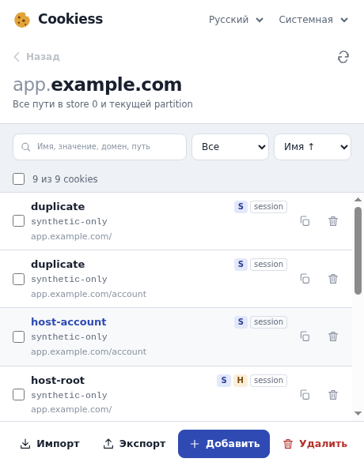
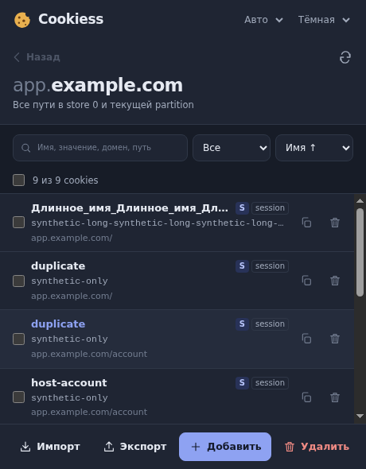
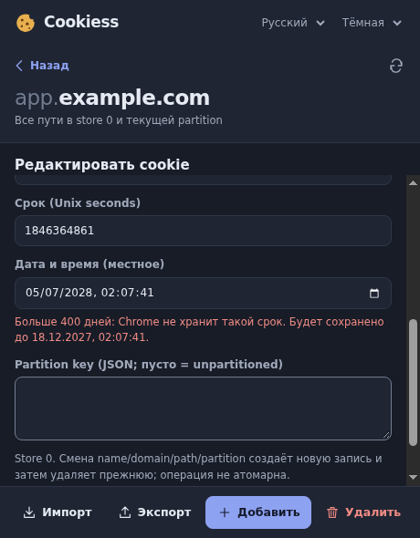
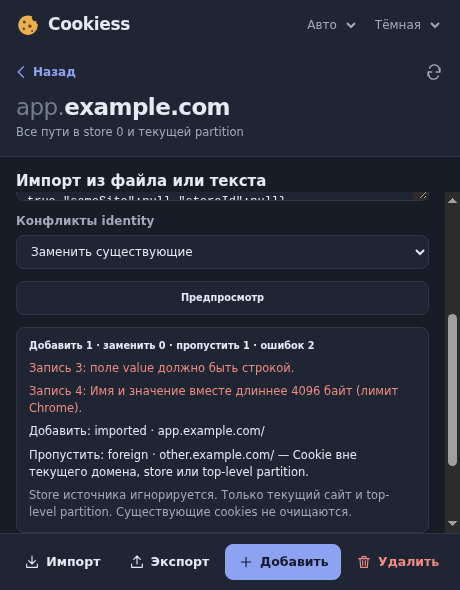
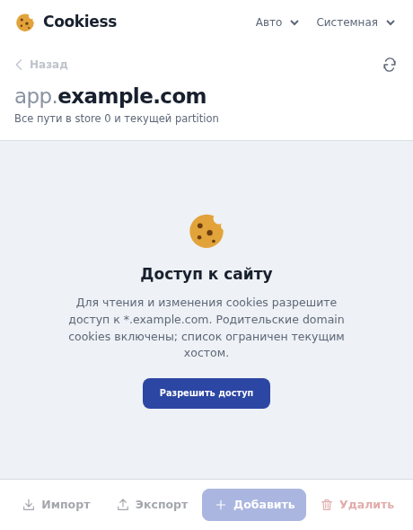

<div align="center">

[English](README.md) · **Русский**


# Cookiess

**Локальный менеджер cookies текущего сайта для Chrome**

Просмотр, редактирование, импорт и экспорт — без сервера, аналитики и сетевых запросов.

[](https://github.com/smallp80380/cookiess/actions/workflows/ci.yml)
[](https://github.com/smallp80380/cookiess/releases/latest)
[](LICENSE)


[**Скачать**](https://github.com/smallp80380/cookiess/releases/latest/download/cookiess-latest.zip) · [Установка](#установка) · [Возможности](#возможности) · [Конфиденциальность](#конфиденциальность) · [Разработка](#разработка)

<br>

&nbsp;&nbsp;

</div>

## Возможности

- **Все cookies сайта в одном списке** — на любых путях, включая родительские домены и partitioned cookies текущего сайта. Чужие домены, другие вкладки и сторонние iframe в список не попадают.
- **Быстрый поиск** по имени, значению, домену и пути; фильтр по флагам Secure, HttpOnly, session и partitioned; сортировка по имени, домену, пути или сроку.
- **Понятный срок действия** — «через 3 дн.» прямо в списке, точная дата в подсказке, в редакторе — дата и время в местном часовом поясе.
- **Полный редактор атрибутов** с проверкой ввода: домен, путь, Secure, HttpOnly, SameSite, срок, partition key. Префиксы `__Host-` и `__Secure-` проверяются по правилам браузера.
- **Декодирование значений** — URL, Base64 и JWT показываются в читаемом виде.
- **Безопасное удаление** — подтверждение, необязательная резервная копия и кнопка «Отменить», пока popup открыт.
- **Импорт и экспорт** в Cookiess JSON, Cookie-Editor JSON и Netscape `cookies.txt` с предпросмотром, политикой конфликтов и прогрессом.
- **Русский и английский интерфейс**, светлая, тёмная и системная темы, горячая клавиша <kbd>Alt</kbd>+<kbd>Shift</kbd>+<kbd>K</kbd>.

<table>
  <tr>
    <td width="33%"></td>
    <td width="33%"></td>
    <td width="33%"></td>
  </tr>
  <tr>
    <td align="center"><sub>Редактор и срок действия</sub></td>
    <td align="center"><sub>Предпросмотр импорта</sub></td>
    <td align="center"><sub>Запрос доступа к сайту</sub></td>
  </tr>
</table>

<sub>Все скриншоты — настоящий popup расширения с искусственными тестовыми данными.</sub>

## Установка

1. Скачайте [`cookiess-latest.zip`](https://github.com/smallp80380/cookiess/releases/latest/download/cookiess-latest.zip) и распакуйте его в постоянную папку.
2. Откройте `chrome://extensions` и включите **Режим разработчика**.
3. Нажмите **Загрузить распакованное расширение** и выберите папку с `manifest.json`.
4. Закрепите Cookiess на панели, откройте любой HTTP/HTTPS-сайт и нажмите на иконку.
5. При первом открытии сайта нажмите **Разрешить доступ** и подтвердите запрос Chrome.

**Обновление.** Распакуйте новый архив в ту же папку и нажмите «Обновить» в `chrome://extensions`. Если загрузить версию из другой папки, Chrome создаст второе расширение, а старая иконка на панели может вести на удалённую папку и показывать `ERR_FILE_NOT_FOUND` — удалите старую установку.

Работает в Chrome 132+ и браузерах на Chromium. В режиме инкогнито — только если вы отдельно разрешили это в настройках расширения; обычные и приватные cookies не смешиваются.

## Как это работает

**Доступ.** Cookiess не получает доступ ко всем сайтам сразу. Разрешение запрашивается для зарегистрированного домена открытого сайта (например, `*.example.com`) — это нужно, чтобы видеть cookies родительского домена. Для `localhost` и IP-адресов доступ выдаётся на сам хост. Отозвать разрешение можно в настройках расширения.

**Изменения.** Перед каждой записью Cookiess заново проверяет вкладку и разрешение, а после записи перечитывает реальный результат из Chrome. Если вкладка перешла на другой сайт, запись блокируется до обновления.

**Переименование.** Смена имени, домена, пути или partition создаёт новую cookie и затем удаляет прежнюю. Браузер не даёт сделать это атомарно, поэтому при сбое Cookiess сообщит, что обе записи остались в списке.

**Неоднозначное удаление.** API Chrome удаляет cookie по URL и имени. Если этому URL соответствуют несколько одноимённых cookies, Cookiess откажется удалять и подскажет порядок — сначала запись с более коротким путём.

## Форматы файлов

| Формат | Что сохраняет | Ограничения |
| --- | --- | --- |
| **Cookiess JSON** | Все атрибуты Chrome и полный partition key | — |
| **Cookie-Editor JSON** | Массив объектов, совместимый с Cookie-Editor | Не переносит store; `sameSite: null` означает Unspecified |
| **Netscape `cookies.txt`** | Домен, путь, Secure, HttpOnly, срок, имя, значение | Теряет SameSite, store и partition; не допускает табуляций и переводов строк в значениях |

Импорт всегда пишет в store текущей вкладки, пропускает записи других доменов и не удаляет существующие cookies. Размер файла — до 10 МБ. Срок больше 400 дней сокращается до лимита Chrome, и это видно в предпросмотре.

Восстановление cookies из файла не гарантирует, что сайт примет старую сессию.

## Конфиденциальность

Cookiess работает только на вашем устройстве: никаких серверов, аналитики, рекламы и удалённого кода. Значения cookies не сохраняются в хранилище расширения и не пишутся в логи; файлы и буфер обмена используются только по вашему действию.

| Разрешение | Зачем |
| --- | --- |
| `cookies` | Чтение и изменение cookies |
| `activeTab` | Адрес сайта при нажатии на иконку — без доступа к истории и другим вкладкам |
| `storage` | Выбранные тема и язык |
| Доступ к сайтам (по запросу) | Cookies открытого сайта и его родительского домена — только после вашего подтверждения |

Полный текст: [политика конфиденциальности](https://smallp80380.github.io/cookiess/) ([исходник](PRIVACY.md)).

## Разработка

Нужны Node.js 22.12+ и npm.

```sh
npm ci
npm run dev          # пересборка dist/ при изменениях → «Обновить» в chrome://extensions
npm run build        # сборка в dist/
npm run package      # сборка и ZIP в artifacts/ (нужен python3)
```

| Команда | Проверка |
| --- | --- |
| `npm run typecheck` | TypeScript |
| `npm run lint` | ESLint для `src`, `tests` и `scripts` |
| `npm run format:check` | Prettier (`npm run format` — исправить) |
| `npm test` | Юнит-тесты Vitest |
| `npm run test:coverage` | Юнит-тесты с порогами покрытия |
| `npm run test:browser` | Сценарии в настоящем popup Chromium |

Браузерные тесты запускают распакованное расширение в отдельном временном профиле и проходят 22 сценария в настоящем popup: разрешения, редактирование, импорт и экспорт, инкогнито. Нужны Linux, Xvfb, xdotool и Chromium 154+:

```sh
CHROMIUM_PATH=/usr/bin/chromium xvfb-run -a npm run test:browser
```

Тесты используют только синтетические cookies и перезаписывают снимки в `screenshots/`. Подробности — в [VERIFICATION.md](VERIFICATION.md).

### Структура

```text
src/
  main.ts        интерфейс popup
  api.ts         работа с Chrome API: доступ, запись, удаление, импорт
  domain.ts      правила доменов, identity cookies, проверка атрибутов
  formats.ts     разбор и запись трёх форматов файлов
  view.ts        фильтры, сортировка, сроки
  decode.ts      URL, Base64, JWT
  i18n.ts        выбор языка; строки — в src/locales/
public/          manifest.json, иконки, _locales/
tests/           юнит-тесты
scripts/         браузерные тесты, упаковка, релизы
```

### Релизы

Каждый коммит в `main`, прошедший CI на Linux, Windows и macOS и браузерные проверки, публикуется как [релиз](https://github.com/smallp80380/cookiess/releases) с версией `X.Y.Z.N`: базовая версия из `package.json` и номер сборки. К релизу прикладываются ZIP, SHA-256 и `build-info.json`. Чтобы начать новую линейку версий, измените `version` в `package.json` и `public/manifest.json`.

## Документация

- [ROADMAP.md](ROADMAP.md) — план развития
- [CHANGELOG.md](CHANGELOG.md) — история изменений
- [DESIGN.md](DESIGN.md) — визуальный стиль
- [CONTRIBUTING.md](CONTRIBUTING.md) — как предложить изменения
- [SECURITY.md](SECURITY.md) — как сообщить об уязвимости
- [store/](store/) — материалы для Chrome Web Store

## Лицензия

[MIT](LICENSE). Лицензии встроенных компонентов (tldts, шрифт Onest под SIL OFL 1.1) — в [THIRD_PARTY_NOTICES.txt](public/THIRD_PARTY_NOTICES.txt).
